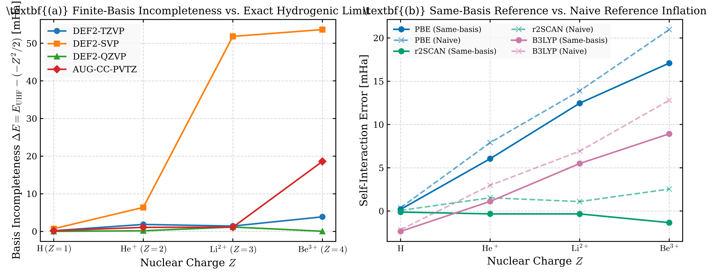
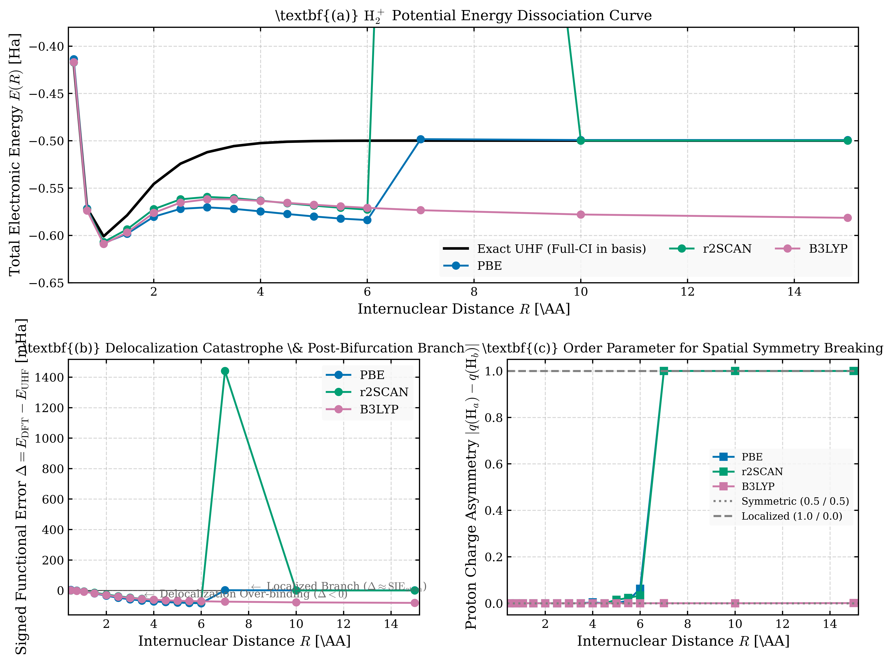

# One-Electron Diagnostics for Machine-Learned Exchange–Correlation Functionals

[](https://www.python.org/)
[](https://pyscf.org/)
[]()
[]()

**Author**: Dalton Omondi  
**Affiliation**: Electrical and Electronics Engineering // Kenyatta University  
**Topic**: Empirical Self-Interaction Diagnostics, Basis-Incompleteness Corrections, and Symmetry-Breaking Bifurcations in Density Functional Theory

---

## 1. Overview & Theoretical Framework

Machine-learned (ML) exchange–correlation functionals are frequently trained against extensive thermochemical and molecular equilibrium geometries. It has come to the attention of the author that their physical behavior under extreme one-electron regimes—where the exact Hartree–Fock exchange energy is identical to the exact Full Configuration Interaction (FCI) limit—reveals fundamental diagnostic properties worth looking into.

This repository contains the computational verification suite and empirical dataset evaluating:
1. **The Same-Basis Reference**: Demonstrating that naive self-interaction error (SIE) measurements ($E_{\text{DFT}} - E_{\text{exact}}^\infty$) are contaminated by basis incompleteness (up to **49.5%** in triple-$\zeta$ sets), whereas the same-basis reference ($E_{\text{DFT}} - E_{\text{UHF}}^{\text{basis}}$) isolates pure functional error.
2. **The B3LYP Delocalization Anomaly**: Resolving why B3LYP plunges to $-78.082\ \text{mHa}$ on stretched $\text{H}_2^+$ at $R = 10\ \text{\AA}$ (the symmetric saddle-point solution with fractional charges $q_a = q_b = 0.5$ under semilocal convex bowing).
3. **The PBE / r2SCAN Symmetry Transition**: Showing that semilocal functionals undergo a pitchfork bifurcation at $R_c \approx 5.5\text{--}6.0\ \text{\AA}$, collapsing onto the localized atomic branch ($q_a = 0.000, q_b = 1.000$) where $\Delta > 0$ reflects one-center atomic self-interaction.
4. **Regularization Necessity in meta-GGAs**: Documenting the complete numerical divergence of standard SCAN on bare hydrogenic cations ($\text{Li}^{2+}$ and $\text{Be}^{3+}$, error $> 6900\ \text{mHa}$) and demonstrating how `r2SCAN` makes up for this divergence.

---

## 2. Key Empirical Findings

### A. Basis Incompleteness of the Same-Basis Reference (Table 4.1)
The basis-incompleteness error is defined as $\Delta_{\text{basis}} = E_{\text{UHF}}^{\text{basis}} - \left(-\frac{Z^2}{2}\right)$.

| Basis Set | Ion | $Z$ | $E_{\text{exact}}^\infty$ (Ha) | $E_{\text{UHF}}^{\text{basis}}$ (Ha) | Incompleteness (mHa) |
| :--- | :--- | :---: | :---: | :---: | :---: |
| **`def2-TZVP`** | H | 1 | $-0.500000$ | $-0.499810$ | **$0.190168$** |
| | He$^+$ | 2 | $-2.000000$ | $-1.998140$ | **$1.860271$** |
| | Li$^{2+}$ | 3 | $-4.500000$ | $-4.498572$ | **$1.427993$** |
| | Be$^{3+}$ | 4 | $-8.000000$ | $-7.996125$ | **$3.874777$** |
| **`def2-SVP`** | H | 1 | $-0.500000$ | $-0.499278$ | **$0.721594$** |
| | He$^+$ | 2 | $-2.000000$ | $-1.993623$ | **$6.376840$** |
| | Li$^{2+}$ | 3 | $-4.500000$ | $-4.448185$ | **$51.815280$** |
| | Be$^{3+}$ | 4 | $-8.000000$ | $-7.946371$ | **$53.628630$** |
| **`def2-QZVP`** | H | 1 | $-0.500000$ | $-0.499983$ | **$0.016702$** |
| | He$^+$ | 2 | $-2.000000$ | $-1.999832$ | **$0.167783$** |
| | Li$^{2+}$ | 3 | $-4.500000$ | $-4.498834$ | **$1.165674$** |
| | Be$^{3+}$ | 4 | $-8.000000$ | $-7.999955$ | **$0.044524$** |
| **`aug-cc-pVTZ`** | H | 1 | $-0.500000$ | $-0.499821$ | **$0.178824$** |
| | He$^+$ | 2 | $-2.000000$ | $-1.998921$ | **$1.078896$** |
| | Li$^{2+}$ | 3 | $-4.500000$ | $-4.498876$ | **$1.123980$** |
| | Be$^{3+}$ | 4 | $-8.000000$ | $-7.981410$ | **$18.589638$** |

*Non-Monotonicity Note*: In `def2-TZVP`, $\text{He}^+$ has larger incompleteness than $\text{Li}^{2+}$ because Karlsruhe basis sets are parameterized for neutral atom valence states rather than bare hydrogenic cations. In `def2-QZVP`, this gap collapses to the sub-millihartree range ($0.168\ \text{mHa}$ vs $1.166\ \text{mHa}$).

---

### B. Self-Interaction Error Diagnostics (Table 4.2 & 4.3)
Comparison between naive SIE and same-basis SIE in `def2-TZVP`:

| Functional | Ion | $Z$ | $E_{\text{DFT}}$ (Ha) | $\text{SIE}_{\text{naive}}$ (mHa) | $\text{SIE}_{\text{same}}$ (mHa) | Inflation Ratio | Note |
| :--- | :--- | :---: | :---: | :---: | :---: | :---: | :--- |
| **PBE** | H | 1 | $-0.4996$ | $+0.3843$ | $+0.1942$ | **$1.9794$** | Basis error is 49.5% of naive SIE |
| | He$^+$ | 2 | $-1.9921$ | $+7.9097$ | $+6.0494$ | **$1.3075$** | |
| | Li$^{2+}$ | 3 | $-4.4861$ | $+13.8899$ | $+12.4619$ | **$1.1146$** | |
| | Be$^{3+}$ | 4 | $-7.9790$ | $+20.9689$ | $+17.0941$ | **$1.2267$** | |
| **r2SCAN** | H | 1 | $-0.4999$ | $+0.0734$ | $-0.1167$ | **$-0.6290$** | Sign inversion under same-basis ref |
| | He$^+$ | 2 | $-1.9985$ | $+1.5349$ | $-0.3254$ | **$-4.7173$** | |
| | Li$^{2+}$ | 3 | $-4.4989$ | $+1.0997$ | $-0.3283$ | **$-3.3494$** | |
| | Be$^{3+}$ | 4 | $-7.9975$ | $+2.5405$ | $-1.3342$ | **$-1.9041$** | |
| **SCAN** | Li$^{2+}$ | 3 | $+2.4206$ | $+6920.6256$ | $+6919.1976$ | $1.0002$ | **Diverged** (tau-ratio singularity) |
| | Be$^{3+}$ | 4 | $-0.3955$ | $+7604.5437$ | $+7600.6690$ | $1.0005$ | **Diverged** (tau-ratio singularity) |
| **B3LYP** | H | 1 | $-0.5022$ | $-2.1542$ | $-2.3444$ | **$0.9189$** | Hybrid exchange |
| | He$^+$ | 2 | $-1.9970$ | $+2.9782$ | $+1.1179$ | **$2.6641$** | |
| | Li$^{2+}$ | 3 | $-4.4931$ | $+6.9206$ | $+5.4926$ | **$1.2600$** | |
| | Be$^{3+}$ | 4 | $-7.9872$ | $+12.7975$ | $+8.9227$ | **$1.4343$** | |

---

### C. Stretched $\text{H}_2^+$ Dissociation & Symmetry-Breaking Bifurcation

| $R$ (\AA) | UHF $E$ (Ha) | PBE $\Delta$ (mHa) | PBE $q_a, q_b$ | r2SCAN $\Delta$ (mHa) | r2SCAN $q_a, q_b$ | B3LYP $\Delta$ (mHa) | B3LYP $q_a, q_b$ |
| :---: | :---: | :---: | :---: | :---: | :---: | :---: | :---: |
| **1.06** (eq) | $-0.600965$ | $-7.359$ | $0.500, 0.500$ | $-6.066$ | $0.500, 0.500$ | $-8.067$ | $0.500, 0.500$ |
| **3.00** | $-0.512060$ | $-58.304$ | $0.500, 0.500$ | $-47.267$ | $0.500, 0.500$ | $-49.731$ | $0.500, 0.500$ |
| **5.00** | $-0.500305$ | $-79.654$ | $0.500, 0.500$ | $-68.273$ | $0.493, 0.507$ | $-67.263$ | $0.500, 0.500$ |
| **6.00** | $-0.499900$ | **$-83.878$** | $0.531, 0.469$ | **$-72.825$** | $0.483, 0.517$ | $-70.984$ | $0.500, 0.500$ |
| **7.00** | $-0.499828$ | **$+1.552$** | **$0.000, 1.000$** | $+1440.856$ | **$0.000, 1.000$** | $-73.538$ | $0.500, 0.500$ |
| **10.00** | $-0.499812$ | **$+0.619$** | **$0.000, 1.000$** | **$+0.025$** | **$0.000, 1.000$** | **$-78.082$** | **$0.500, 0.500$** |
| **15.00** | $-0.499810$ | **$+0.590$** | **$0.000, 1.000$** | **$-0.010$** | **$0.000, 1.000$** | **$-81.612$** | **$0.500, 0.500$** |

* **The Bifurcation Transition**: At $R_c \approx 5.5\text{--}6.0\ \text{\AA}$, the symmetric saddle point becomes unstable for semilocal functionals. PBE and r2SCAN spontaneously collapse to the localized branch ($q_a = 0.000, q_b = 1.000$).
* **The B3LYP Saddle Point**: Under default symmetric initial guesses, B3LYP stays locked on the symmetric saddle point ($q_a = 0.500, q_b = 0.500$), over-stabilizing the system by $-78.082\ \text{mHa}$ at $R = 10\ \text{\AA}$.

---

## 3. Publication Figures

| Figure 1: Basis-Incompleteness Scaling | Figure 2: $\text{H}_2^+$ Dissociation Bifurcation |
| :---: | :---: |
|  |  |
| Multi-basis scaling (`def2-SVP`, `def2-TZVP`, `def2-QZVP`, `aug-cc-pVTZ`) showing non-monotonicity in `def2-TZVP` and decay toward CBS limit. | Dissociation curves and order parameter $|\Delta q(R)| = \|q_a - q_b\|$ showing pitchfork bifurcation at $R_c \approx 5.5\text{--}6.0\ \text{\AA}$. |

---

## 4. Repository Structure

```text
.
├── README.md                           # research documentation
├── working_report.tex                  # LaTeX report & manuscript draft
├── master_dft_one_electron_dataset.csv # dataset (98 verified SCF runs)
├── plot_diagnostics.py                 # plotting script (JCTC/JCP 600 DPI vector)
├── fig1_basis_incompleteness.pdf       
├── fig1_basis_incompleteness.png       
├── fig2_h2plus_bifurcation.pdf         
├── fig2_h2plus_bifurcation.png       
└── kaggle_kernel/                      # kaggle notebook for experiments
    ├── build_notebook.py               
    ├── run_verification.py            
    ├── kernel-metadata.json           
    └── verification_notebook.ipynb    
```

---

## 5. Reproduction Instructions

### Local Environment
1. Clone the repository:
   ```bash
   git clone https://github.com/GabuGravin41/dftex-func-.git
   cd dftex-func-
   ```
2. Install dependencies:
   ```bash
   pip install pyscf pandas tabulate matplotlib seaborn
   ```
3. Generate the publication figures:
   ```bash
   python plot_diagnostics.py
   ```

### Cloud Execution (Kaggle Compute)
To push and execute the suite on Kaggle:
```bash
cd kaggle_kernel
kaggle kernels push -p .
```

---

## 6. Citation

If you use this dataset, reference implementation, or findings, cite as:

```bibtex
@article{omondi2026oneelectron,
  author    = {Omondi, Dalton},
  title     = {One-Electron Diagnostics for Machine-Learned Exchange--Correlation Functionals: Same-Basis References and Symmetry-Breaking Bifurcations},
  journal   = {Working Research Report / J. Chem. Theory Comput.},
  year      = {2026},
  url       = {https://github.com/GabuGravin41/dftex-func-}
}
```
